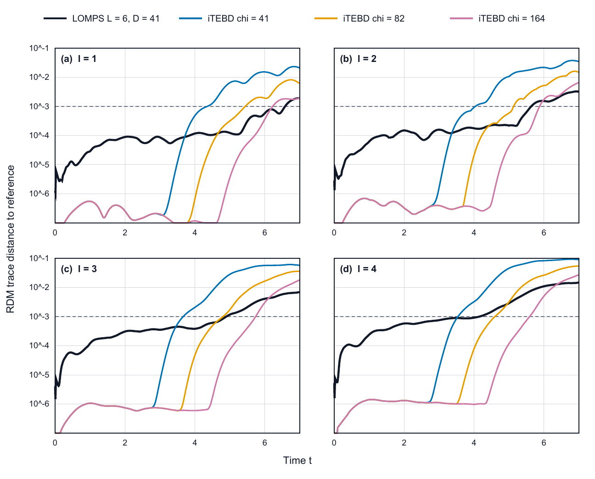

# LOMPS

LOMPS (local optimization of matrix-product states) approximates infinite-system
quantum dynamics by matching a finite reduced density matrix after each time
step. The closure is a uniform, left-canonical matrix-product state (uMPS), so
the calculation works directly in the thermodynamic limit.

The package provides:

- finite-block reduced density matrices and analytic derivatives;
- second-order Ising-quench protocols for even and odd matching windows;
- gauge-aware Levenberg--Marquardt optimization on the MPS manifold;
- dense and matrix-free optimization backends;
- product-state and lower-bond-dimension initialization;
- checkpointed, resumable trajectories with recorded optimizer diagnostics;
- compact reference data for integrable and nonintegrable benchmarks.

## Paper, code snapshot and data

The method is described in:

> Carolin Wille, Maximilian Marvell, Lauren Stewart, Maximillian Murphy,
> Vinul Wimalaweera, Lesley Gover and Andrew G. Green,
> *Locally optimized variational evolution for quantum many-body systems*,
> [arXiv:2609.20802](https://arxiv.org/abs/2609.20802) (2026).

The manuscript identifies commit
[`923037b`](https://github.com/rho-tilde/lomps/tree/923037b) as its fixed code
snapshot. The default branch contains later documentation and reproducibility
additions without changing that archived snapshot.

The full numerical and hardware dataset is archived in the UCL Research Data
Repository at [doi:10.5522/04/33898246](https://doi.org/10.5522/04/33898246).
The repository includes compact reference files needed for quick regression
tests and figure-level checks; large production trajectories remain in the
DOI-backed archive.

## Installation

LOMPS requires Python 3.11 or newer, NumPy 1.26 or newer and SciPy 1.11
or newer. The regression suite runs in GitHub Actions on Ubuntu with Python
3.12; the exact NumPy and SciPy versions used for the manuscript snapshot are
listed in `requirements-tested.txt`. The quick demonstration below was also
verified on macOS 27.2 with Python 3.12.14, NumPy 2.4.6 and SciPy 1.17.1.

A standard desktop computer is sufficient for installation, testing and the
quick demonstration; no non-standard hardware is required. Large production
trajectories, particularly at large patch size and bond dimension, can require
high-performance-computing resources.

```bash
python -m venv .venv
source .venv/bin/activate
python -m pip install --upgrade pip
python -m pip install -e .
```

On an internet-connected modern desktop, installation typically takes two to
five minutes when binary NumPy and SciPy packages are available.

## Quick start

Run the compact ten-step example:

```bash
python examples/ten_step_quench.py
```

The demonstration uses the included input
`data/nonintegrable_d12_t0p001.npy` and requires no external data. It prints
ten lines containing the step number, physical time, optimization cost and
residual norm. Approximate reference costs are provided in
`data/ten_step_d12_reference.json`. A successful run begins and ends with
output of the following form:

```text
step=01 time=0.002 cost=1.740864e-15 residual=5.900617e-08
...
step=10 time=0.011 cost=2.643354e-16 residual=2.299284e-08
```

The demonstration completed in approximately 20--25 seconds on the tested
desktop described above.

For a checkpointed trajectory, use `lomps-run`:

```bash
lomps-run \
  --initial-A data/nonintegrable_d10_t3p235.npy \
  --output-dir runs/d10 \
  --bond-dimension 10 \
  --block-length 4 \
  --fixed-point-solver dense \
  --accept-cost 3e-16 \
  --steps 100 \
  --base-time 3.235
```

Create `runs/d10/PAUSE` to stop cleanly between time steps. Remove the file and
repeat the command with `--resume` to continue.

## Algorithm

For a current uMPS tensor `A`, LOMPS constructs the locally evolved target
state on an `L`-site window and finds the next tensor `B` by minimizing

```text
C(B) = 1/2 ||rho_L(B) - target_L(A)||_F^2.
```

The optimizer removes infinitesimal MPS gauge directions, evaluates the RDM
derivative on the remaining tangent space, and retracts accepted steps to the
left-canonical manifold. Even windows use a symmetric `L+4`-site light cone.
Odd windows use an `L+5`-site light cone and average the two parity-related
reductions.

See [docs/algorithm.md](docs/algorithm.md) for the mathematical outline.

## Initial states

`--initial-A` accepts

- a product vector with shape `(d,)`;
- an MPS tensor with shape `(d,D,D)`; or
- a singleton tensor batch with shape `(1,d,D,D)`.

MPS tensors use `(physical,left,right)` order and must be left canonical. Keyed
`.npz` files and historical `(left,physical,right)` arrays can be loaded with
`--initial-key` and `--initial-layout`. `lomps-convert-tensor` converts legacy
inputs and writes a provenance sidecar.

If the input bond dimension is smaller than the requested trajectory bond
dimension, LOMPS builds the first physical target from the original input and
uses a separate lifted tensor only as the optimizer seed. The default first
step combines fixed-target conjugate gradient with an LM polish. Later time
steps use the accepted high-dimensional trajectory tensor.

See [docs/product_starts.md](docs/product_starts.md) for commands and parameter
recommendations.

## Large-window calculations

Dense LM is the reference backend for the established `L=4,D=12` and
`L=5,D=20/21` regimes. For larger problems, select the matrix-free backend:

```bash
lomps-run \
  --optimizer matrix-free-lm \
  --matrix-free-krylov-preconditioner right-fixed-point-stiefel \
  --initial-A data/your_tensor.npy \
  --output-dir runs/matrix_free \
  --bond-dimension 40 \
  --block-length 6 \
  --steps 100
```

This backend applies the RDM Jacobian and its adjoint through local
contractions rather than storing the full Jacobian. Krylov tolerances, budgets,
and contraction counts are written to the run directory. Dense and
matrix-free runs use the same checkpoint and resume format.

For trajectories that increase the bond dimension only when the current
manifold cannot accept the next update, see
[docs/adaptive_bond_runs.md](docs/adaptive_bond_runs.md). The safeguards used
for large dense Jacobians are described in
[docs/large_jacobian_blas_safety.md](docs/large_jacobian_blas_safety.md).

## Integrable TFIM reference

The repository contains VUMPS ground-state tensors for the quench

```text
H0 = -sum_j Z_j Z_(j+1) - 1.5 sum_j X_j
H1 = -sum_j Z_j Z_(j+1) - 0.2 sum_j X_j.
```

The named `integrable-tfim` protocol fixes the historical Hamiltonian and
Trotter conventions. Exact production commands, tensor provenance, and resume
instructions are collected in
[docs/integrable_benchmarks.md](docs/integrable_benchmarks.md).

Generate the independent free-fermion reference with

```bash
python examples/generate_free_fermion_reference.py
```

The output contains the transverse magnetization and local Hilbert--Schmidt
Loschmidt signature on the production time grid.

## Finite-bond-dimension iTEBD benchmark

The finite-bond-dimension iTEBD trajectories used in the paper's comparison
with `L=6`, `D=41` LOMPS are provided in
[`data/itebd_yplus/`](data/itebd_yplus/). The directory contains the capped
trajectories for `chi = 41, 82, 164`, plot-ready trace distances and full
provenance notes. The independent two-site iTEBD implementation can be rerun
with, for example,

```bash
python scripts/run_capped_itebd_yplus.py \
  --max-chi 41 --dt 0.001 --t-final 7 --sample-dt 0.01 \
  --max-rdm-length 4 --svd-cutoff 1e-8 \
  --output data/itebd_yplus/yplus_itebd_chi41_dt1e-3_t7.npz
```



## Output and conventions

Trajectory tensors are stored in `states.npy`; aligned right transfer fixed
points are stored in `right_fixed_points.npy`. Metadata and step ledgers record
the resolved protocol, optimizer settings, costs, restart decisions, and wall
times. The target remains fixed during every restart of a physical time step.

The main conventions are

```text
A.shape = (physical, left, right)
sum_s A[s]^dagger A[s] = I
C = 1/2 ||rho_L(A_fit) - rho_target||_F^2.
```

## Tests

Run the test suite with

```bash
python -m unittest discover -s tests
```

The integrable production path has a separate three-step regression:

```bash
python -m unittest discover -s tests -p 'test_integrable.py'
```

## Documentation

- [Algorithm](docs/algorithm.md)
- [Product-state starts](docs/product_starts.md)
- [Adaptive bond-dimension trajectories](docs/adaptive_bond_runs.md)
- [Integrable TFIM benchmark](docs/integrable_benchmarks.md)
- [Large-Jacobian BLAS safety](docs/large_jacobian_blas_safety.md)

## Citation

Please cite the paper and the archived dataset when using this software or its
reference data. Machine-readable citation metadata are provided in
[`CITATION.cff`](CITATION.cff).

```bibtex
@article{Wille2026LOMPS,
  author        = {Wille, Carolin and Marvell, Maximilian and Stewart, Lauren and
                   Murphy, Maximillian and Wimalaweera, Vinul and Gover, Lesley and
                   Green, Andrew G.},
  title         = {Locally optimized variational evolution for quantum many-body systems},
  year          = {2026},
  eprint        = {2609.20802},
  archivePrefix = {arXiv},
  primaryClass  = {quant-ph},
  url           = {https://arxiv.org/abs/2609.20802}
}
```

## License

This software is licensed under the [Apache License 2.0](LICENSE).
Copyright 2026 University College London. See [`NOTICE`](NOTICE) for the
copyright notice.
